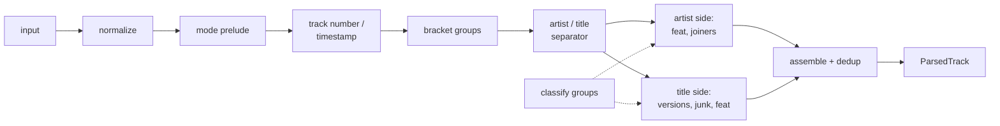

<div align="center">

# trackparse

**Turn messy track names into structured data: who made it, who's featured, who remixed it, and what's just noise.**

[](https://www.npmjs.com/package/trackparse)
[](https://pypi.org/project/trackparse/)
[](https://crates.io/crates/trackparse)
[](https://docs.rs/trackparse)
[](https://pkg.go.dev/github.com/4matic/trackparse/go)
<br>
[](https://github.com/4matic/trackparse/actions/workflows/js.yml)
[](https://github.com/4matic/trackparse/actions/workflows/python.yml)
[](https://github.com/4matic/trackparse/actions/workflows/rust.yml)
[](https://github.com/4matic/trackparse/actions/workflows/go.yml)
[](https://github.com/4matic/trackparse/actions/workflows/spec.yml)
<br>
[](#how-its-tested)
[](LICENSE)
[](https://4matic.github.io/trackparse/)

**[Documentation](https://4matic.github.io/trackparse/)** · **[Playground](https://4matic.github.io/trackparse/playground/)** · [Install](#install) · [Quick start](#quick-start) · [What it understands](#what-it-understands) · [Tracklists](#tracklists) · [API](#api) · [How it's tested](#how-its-tested) · [Ports](#ports) · [Spec](spec/SPEC.md)

</div>

```text
01. Wilkinson ft. Becky Hill & Tom Cane - Afterglow (Sub Focus VIP Remix) [Official Video]
└┬┘ └───┬───┘ └───────────┬───────────┘   └───┬───┘ └─────────┬─────────┘ └───────┬──────┘
 │      │                 │                   │               │                   │
 position 1               featured ×2         title           remix · Sub Focus · vip
        │                                                                         │
        primary                                                                   junk: video
```

Most title parsers give you `["Wilkinson ft. Becky Hill & Tom Cane", "Afterglow (Sub Focus VIP Remix)"]`
and stop there. Others "clean" the string and throw the feat and the remix away. Neither tells you
that Becky Hill is featured, that Sub Focus did the remix, or that it's a VIP.

trackparse keeps all of it. Its one rule is **extract, don't delete**: everything it recognizes
goes into a field, and anything it doesn't recognize stays in the title, word for word.

It comes as an npm package, a PyPI package, a Rust crate and a Go module, all named `trackparse`.
One [spec](spec/SPEC.md) and one set of fixtures define the behaviour. The four pass the same
fixtures and give the same output on every fixture input. The example below is JavaScript;
[Quick start](#quick-start) has the same calls in Python, Rust and Go, and you can try any string in
the [playground](https://4matic.github.io/trackparse/playground/).

```js
import { parse } from "trackparse";

const track = parse(
  "01. Wilkinson ft. Becky Hill & Tom Cane - Afterglow (Sub Focus VIP Remix) [Official Video]",
);

track.artists.map((a) => `${a.name} (${a.role})`);
// [ 'Wilkinson (primary)', 'Becky Hill (featured)', 'Tom Cane (featured)' ]
track.title;                        // 'Afterglow'
track.versions[0].type;             // 'remix'
track.versions[0].artists[0].name;  // 'Sub Focus'
track.versions[0].modifiers;        // [ 'vip' ]
track.junk;                         // [ { raw: 'Official Video', kind: 'video' } ]
track.position;                     // { raw: '01', number: 1 }
```

<details>
<summary>Full output</summary>

```json
{
  "input": "01. Wilkinson ft. Becky Hill & Tom Cane - Afterglow (Sub Focus VIP Remix) [Official Video]",
  "mode": "youtube",
  "position": { "raw": "01", "number": 1 },
  "timestamp": null,
  "artists": [
    { "name": "Wilkinson",  "role": "primary",  "joiner": null,  "source": "artist" },
    { "name": "Becky Hill", "role": "featured", "joiner": "ft.", "source": "artist" },
    { "name": "Tom Cane",   "role": "featured", "joiner": "&",   "source": "artist" }
  ],
  "title": "Afterglow",
  "fullTitle": "Afterglow (Sub Focus VIP Remix)",
  "versions": [
    {
      "type": "remix",
      "raw": "Sub Focus VIP Remix",
      "artists": [{ "name": "Sub Focus", "role": "remixer", "joiner": null, "source": "version" }],
      "modifiers": ["vip"],
      "descriptor": null,
      "year": null,
      "unknownArtist": false,
      "delimiter": "("
    }
  ],
  "year": null,
  "flags": { "explicit": false, "clean": false, "unknownArtist": false, "unknownTitle": false },
  "junk": [{ "raw": "Official Video", "kind": "video" }],
  "warnings": []
}
```

Every key is always present. When a guess was involved, `warnings` says which one. Python's
`to_dict()`, Rust's `to_json()` and Go's `MarshalJSON` give this same JSON.

</details>

## At a glance

**Docs:** [Introduction](https://4matic.github.io/trackparse/start/introduction/) · [How it's tested](https://4matic.github.io/trackparse/project/testing/) · [Ports](https://4matic.github.io/trackparse/project/ports/)

| Number | What it means |
|---|---|
| **13,130** shared fixtures | 1,203 written by hand, 11,927 generated from combinations. 100% pass in JS, Python, Rust and Go, nothing skipped. |
| **1,239** of them on tracklists | 303 handwritten, 936 generated. They cover line splitting, times, bullets and Markdown, warnings and edits |
| **1,352** JS tests | Every fixture, a schema check on every output, property-based tests of the spec invariants, API tests |
| **27** version types | Remix, VIP, bootleg, extended, radio, original, live, remaster, sped up and more |
| **0** dependencies in JS, Python and Go | The Rust crate has one, `unicode-normalization`. The JS package is ESM + CJS with TypeScript types, about 18 kB gzipped. `trackparse/tracklist` adds about 8.4 KiB, only if you import it |
| **Node 18+** | CI runs the full suite on 22 and 24, and every fixture against the built package on 18 and 20 |
| **Python 3.9+** | 1,342 pytest tests on 3.9 to 3.14, plus every fixture against the built wheel. Output is byte-identical to JS |
| **Rust 1.74+** | Every fixture, the tracklist invariants and the typed API tests on stable and on 1.74. Output is byte-identical to JS on every fixture and on about 790,000 random inputs |
| **Go 1.22+** | Every fixture, the spec invariants and the examples with `go test -race` on 1.22 and on the latest stable. Output is byte-identical to JS on every fixture |
| **5,031** real tracklist lines | 117 podcast tracklists the tracklist rules were checked against. Every line round-trips byte for byte |
| **1** spec | [`spec/SPEC.md`](spec/SPEC.md) defines the behaviour. The packages share its version (0.5.1 today) and are released together |

## Install

**Docs:** [Getting started](https://4matic.github.io/trackparse/start/getting-started/)

JavaScript and TypeScript ([npm](https://www.npmjs.com/package/trackparse), [package README](js/README.md)).
Node 18+ or any runtime with ES2020, no dependencies:

```sh
npm install trackparse   # or: pnpm add / yarn add / bun add trackparse
```

Python ([PyPI](https://pypi.org/project/trackparse/), [package README](python/README.md)).
Python 3.9+, no dependencies:

```sh
pip install trackparse   # or: uv add trackparse
```

Rust ([crates.io](https://crates.io/crates/trackparse), [docs.rs](https://docs.rs/trackparse),
[crate README](rust/README.md)). Rust 1.74+, one dependency (`unicode-normalization`):

```sh
cargo add trackparse   # add --features serde for Serialize / Deserialize on the types
```

Go ([pkg.go.dev](https://pkg.go.dev/github.com/4matic/trackparse/go),
[module README](go/README.md)). Go 1.22+, no dependencies. The import path ends in `/go`, the
package is `trackparse`.

```sh
go get github.com/4matic/trackparse/go@latest
```

## Quick start

**Docs:** [Getting started](https://4matic.github.io/trackparse/start/getting-started/) · [Introduction](https://4matic.github.io/trackparse/start/introduction/)

The four examples parse the same strings. The comments show what each expression evaluates to.

### JavaScript

```js
import { parse, parseArtists, format } from "trackparse";

parse("Noisia feat. Foreign Beggars - Shellshock").artists.map((a) => a.name);
// [ 'Noisia', 'Foreign Beggars' ]   (Foreign Beggars has role 'featured')

parse("Queen - Bohemian Rhapsody (Live at Wembley 1986)").versions[0];
// { type: 'live', raw: 'Live at Wembley 1986', artists: [], modifiers: [],
//   descriptor: 'at Wembley', year: 1986, unknownArtist: false, delimiter: '(' }

parseArtists("Sub Focus, Wilkinson & Dimension feat. Kojo").map((a) => `${a.name}:${a.role}`);
// [ 'Sub Focus:primary', 'Wilkinson:primary', 'Dimension:primary', 'Kojo:featured' ]

format(parse("Wilkinson ft. Becky Hill - Afterglow (Sub Focus Remix)"), { feat: "title", joiners: "canonical" });
// 'Wilkinson - Afterglow (feat. Becky Hill) (Sub Focus Remix)'
```

CommonJS works too: `const { parse } = require("trackparse")`. The full JavaScript API, with the
TypeScript types, is in [`js/README.md`](js/README.md).

### Python

Functions are snake_case and results are frozen dataclasses. `to_dict()` gives the spec's JSON
with camelCase keys, the same as the JS package returns.

```python
from trackparse import format_track, parse, parse_artists

track = parse("Noisia feat. Foreign Beggars - Shellshock")
track.artists
# (Artist(name='Noisia', role='primary', joiner=None, source='artist'),
#  Artist(name='Foreign Beggars', role='featured', joiner='feat.', source='artist'))

parse("Queen - Bohemian Rhapsody (Live at Wembley 1986)").versions[0]
# Version(type='live', raw='Live at Wembley 1986', artists=(), modifiers=(),
#         descriptor='at Wembley', year=1986, unknown_artist=False, delimiter='(')

[f"{a.name}:{a.role}" for a in parse_artists("Sub Focus, Wilkinson & Dimension feat. Kojo")]
# ['Sub Focus:primary', 'Wilkinson:primary', 'Dimension:primary', 'Kojo:featured']

format_track(parse("Wilkinson ft. Becky Hill - Afterglow (Sub Focus Remix)"), feat="title", joiners="canonical")
# 'Wilkinson - Afterglow (feat. Becky Hill) (Sub Focus Remix)'

track.to_dict()["artists"][1]
# {'name': 'Foreign Beggars', 'role': 'featured', 'joiner': 'feat.', 'source': 'artist'}
```

Options are keyword arguments: `parse(s, mode="youtube", known_artists=["Chase & Status"])`. The
full Python API is in [`python/README.md`](python/README.md).

### Rust

Results are structs with public fields, and roles, version types and junk kinds are enums.
`to_json()` writes the spec's JSON, byte for byte what `JSON.stringify` gives in JS.

```rust
use trackparse::{format_track_with, parse, parse_artists, FeatPlacement, FormatOptions, JoinerStyle};

let track = parse("Noisia feat. Foreign Beggars - Shellshock");
&track.artists;
// [Artist { name: "Noisia", role: Primary, joiner: None, source: Artist },
//  Artist { name: "Foreign Beggars", role: Featured, joiner: Some("feat."), source: Artist }]

&parse("Queen - Bohemian Rhapsody (Live at Wembley 1986)").versions[0];
// Version { version_type: Live, raw: "Live at Wembley 1986", artists: [], modifiers: [],
//           descriptor: Some("at Wembley"), year: Some(1986), unknown_artist: false, delimiter: Paren }

parse_artists("Sub Focus, Wilkinson & Dimension feat. Kojo")
    .iter().map(|a| format!("{}:{}", a.name, a.role)).collect::<Vec<_>>();
// ["Sub Focus:primary", "Wilkinson:primary", "Dimension:primary", "Kojo:featured"]

let options = FormatOptions::new().feat(FeatPlacement::Title).joiners(JoinerStyle::Canonical);
format_track_with(&parse("Wilkinson ft. Becky Hill - Afterglow (Sub Focus Remix)"), &options);
// "Wilkinson - Afterglow (feat. Becky Hill) (Sub Focus Remix)"

track.artists[1].to_json();
// {"name":"Foreign Beggars","role":"featured","joiner":"feat.","source":"artist"}
```

Options are builders passed to the `_with` form of a function:
`parse_with(s, &ParseOptions::new().known_artists(["Chase & Status"]))`. The full Rust API is in
[`rust/README.md`](rust/README.md) and on [docs.rs](https://docs.rs/trackparse).

### Go

Results are structs with exported fields; fields that can be `null` are pointers. Roles, version
types and junk kinds are typed strings with constants (`trackparse.RoleFeatured`). `json.Marshal`
gives the spec's JSON.

```go
import (
	"encoding/json"
	"fmt"

	trackparse "github.com/4matic/trackparse/go"
)

track := trackparse.Parse("Noisia feat. Foreign Beggars - Shellshock")
for _, a := range track.Artists {
	fmt.Println(a.Name, a.Role)
}
// Noisia primary
// Foreign Beggars featured

v := trackparse.Parse("Queen - Bohemian Rhapsody (Live at Wembley 1986)").Versions[0]
fmt.Println(v.Type, v.Raw, *v.Descriptor, *v.Year)
// live Live at Wembley 1986 at Wembley 1986

var credits []string
for _, a := range trackparse.ParseArtists("Sub Focus, Wilkinson & Dimension feat. Kojo") {
	credits = append(credits, fmt.Sprintf("%s:%s", a.Name, a.Role))
}
fmt.Println(credits)
// [Sub Focus:primary Wilkinson:primary Dimension:primary Kojo:featured]

fmt.Println(trackparse.FormatWith(
	trackparse.Parse("Wilkinson ft. Becky Hill - Afterglow (Sub Focus Remix)"),
	trackparse.FormatOptions{Feat: trackparse.FeatTitle, Joiners: trackparse.JoinersCanonical},
))
// Wilkinson - Afterglow (feat. Becky Hill) (Sub Focus Remix)

b, _ := json.Marshal(track.Artists[1])
fmt.Println(string(b))
// {"name":"Foreign Beggars","role":"featured","joiner":"feat.","source":"artist"}
```

Options are plain structs whose zero value is the default (a field that must be told apart
from its zero value is a pointer, set with `trackparse.Ptr`), passed to the `With` form of a
function: `trackparse.ParseWith(s, trackparse.ParseOptions{KnownArtists: []string{"Chase & Status"}})`.
The full Go API is in [`go/README.md`](go/README.md) and on
[pkg.go.dev](https://pkg.go.dev/github.com/4matic/trackparse/go).

Every example on the [documentation site](https://4matic.github.io/trackparse/) has JavaScript,
Python, Rust and Go tabs.

> [!TIP]
> `&` is a joiner, so `Chase & Status` comes out as two artists. There's no built-in artist
> database. Pass the names you know instead: `parse(s, { knownArtists: ["Chase & Status"] })` in
> JS, `parse(s, known_artists=["Chase & Status"])` in Python,
> `parse_with(s, &ParseOptions::new().known_artists(["Chase & Status"]))` in Rust,
> `ParseWith(s, ParseOptions{KnownArtists: []string{"Chase & Status"}})` in Go.
> See [knownArtists](https://4matic.github.io/trackparse/guides/artists/#knownartists).

## What it understands

**Docs:** [What it understands](https://4matic.github.io/trackparse/guides/what-it-understands/) · [Artists and credits](https://4matic.github.io/trackparse/guides/artists/) · [Versions and remixes](https://4matic.github.io/trackparse/guides/versions/) · [Junk, flags and prefixes](https://4matic.github.io/trackparse/guides/junk-and-flags/)

These are real outputs of `parse(input)` with default options, unless noted. They are the same in
all four languages. To try your own strings, use the
[playground](https://4matic.github.io/trackparse/playground/).

| Input | Artists | Title | Versions / other |
|---|---|---|---|
| `Noisia feat. Foreign Beggars - Shellshock` | Noisia, Foreign Beggars *(feat)* | `Shellshock` | |
| `Silk City - Electricity (with Dua Lipa)` | Silk City, Dua Lipa *(feat)* | `Electricity` | |
| `Skrillex & Diplo x Justin Bieber - Where Are Ü Now` | Skrillex, Diplo, Justin Bieber | `Where Are Ü Now` | |
| `Future - Mask Off (prod. by Metro Boomin)` | Future, Metro Boomin *(producer)* | `Mask Off` | |
| `Linkin Park - Numb (Remix by Skrillex)` | Linkin Park | `Numb` | remix by Skrillex |
| `Dimension - Offshore (Mefjus Remix / Noisia Remix)` | Dimension | `Offshore` | two remixes |
| `Pendulum - Watercolour (Extended VIP Mix)` | Pendulum | `Watercolour` | vip, +extended |
| `Noisia - Stigma (Phace Bootleg)` | Noisia | `Stigma` | bootleg by Phace |
| `Deadmau5 - Strobe (Radio Edit)` | Deadmau5 | `Strobe` | radio |
| `Netsky - Iron Heart (Levela Mix)` | Netsky | `Iron Heart` | remix by Levela |
| `The Beatles - Hey Jude - Remastered 2015` | The Beatles | `Hey Jude` | remaster, 2015 |
| `Taylor Swift - Love Story (Taylor's Version)` | Taylor Swift | `Love Story` | version, "Taylor's" |
| `Kordhell - Murder In My Mind (Slowed + Reverb)` | Kordhell | `Murder In My Mind` | slowed |
| `Eminem - Without Me (Explicit)` | Eminem | `Without Me` | explicit flag |
| `Daft Punk - One More Time (Official Music Video) [HD]` | Daft Punk | `One More Time` | junk: video, quality |
| `Elektronomia - Sky High [NCS Release]` | Elektronomia | `Sky High` | junk: label |
| `Porter Robinson - Shelter - YouTube` | Porter Robinson | `Shelter` | junk: platform |
| `01. Aphex Twin - Xtal` | Aphex Twin | `Xtal` | position 1 |
| `[12:34] Noisia - Stigma` | Noisia | `Stigma` | timestamp 754 s |
| `07_Burial_-_Archangel.mp3` | Burial | `Archangel` | filename mode, position 7 |
| `"Numb" by Linkin Park` *(youtube)* | Linkin Park | `Numb` | warning `bySplit` |
| `Blink-182-All The Small Things` *(youtube)* | Blink-182 | `All The Small Things` | warning `unspacedDashSplit` |
| `Кино - Группа крови (Remastered 2019)` | Кино | `Группа крови` | remaster, 2019 |
| `ID - ID (ID Remix)` | | `ID` | unknown artist, title and remixer |
| `AC/DC - Back In Black` | AC/DC | `Back In Black` | |
| `2 Unlimited - No Limit` | 2 Unlimited | `No Limit` | not a track number |
| `Mumford & Sons - Little Lion Man` | Mumford & Sons | `Little Lion Man` | not split |
| `The Rolling Stones - (I Can't Get No) Satisfaction` | The Rolling Stones | `(I Can't Get No) Satisfaction` | kept as is |

## Tracklists

**Docs:** [Tracklists](https://4matic.github.io/trackparse/guides/tracklists/) · [Editing tracklists](https://4matic.github.io/trackparse/guides/editing-tracklists/) · [Tracklist API](https://4matic.github.io/trackparse/reference/tracklist/)

Mixes and podcasts come with a tracklist: a block of text, one track per line, usually with a start
time in front. The tracklist module reads the whole block: `trackparse/tracklist` in JavaScript,
`trackparse.tracklist` in Python, `trackparse::tracklist` in Rust, and `ParseTracklist` in the
main Go package. Each line gets its kind, its time
and a full `ParsedTrack`. The list as a whole gets checks with line numbers, and edits rewrite only
the lines you name.

Nothing is thrown away here either. Every line comes back with its original text and its own line
ending, so joining `raw + eol` over the entries gives you the input byte for byte. CRLF, LF and CR
all work, and trailing spaces survive.

```js
import { parseTracklist, applyEdits } from "trackparse/tracklist";

const text = [
  "Hour 2",
  "48:20 Noisia - Stigma",
  "52:47 Mefjus & Kasra - Bandwagon (Phace Remix)",
  "56:05 Black Sun Empire - ID",
  "59:31 Alix Perez - Fade Away",
  "01:03:10 Interview with Hybris",
  "01:07:44 Imanu - Sacrifice",
  "00:11:02 Current Value feat. Teddy Killerz - Payload", // typo: should be 01:11:02
  "01:15:36 Hybris - Spinning Top",
].join("\r\n");

const list = parseTracklist(text);

list.entries.map((e) => e.kind);
// [ 'header', 'track', 'track', 'track', 'track', 'marker', 'track', 'track', 'track' ]

const bandwagon = list.entries[2];
bandwagon.time;   // { raw: '52:47', seconds: 3167 }
bandwagon.parts;  // { lead: '', time: '52:47', gap: ' ', rest: 'Mefjus & Kasra - Bandwagon (Phace Remix)' }
bandwagon.track.artists.map((a) => a.name);                          // [ 'Mefjus', 'Kasra' ]
bandwagon.track.versions.map((v) => `${v.type} by ${v.artists[0].name}`); // [ 'remix by Phace' ]
list.entries[3].track.flags.unknownTitle;                            // true (the ID)

list.warnings;
// [
//   { code: 'no-start-at-zero', line: 2, severity: 'info', suggestion: null },
//   { code: 'time-out-of-order', line: 8, severity: 'warning',
//     suggestion: { line: 8, raw: '01:11:02', seconds: 4262 } }
// ]

list.stats;
// { lines: 9, tracks: 7, markers: 1, timed: 8, firstTime: 2900, lastTime: 4536 }
```

`00:11:02` sits between `01:07:44` and `01:15:36`. Changing one digit gives exactly one time that
fits, `01:11:02`, so the warning carries it as a suggestion. When several fixes would fit, or none,
`suggestion` is `null` and you only get the warning.

Edits work on the text and return new text. Apply the suggestion, then push everything from line 5
on back by 45 seconds:

```js
const fix = list.warnings[1].suggestion;
const result = applyEdits(text, [
  { op: "set-time", line: fix.line, seconds: fix.seconds },
  { op: "shift", seconds: 45, from: 5 },
]);

result.changed;   // [ 5, 6, 7, 8, 9 ]
result.warnings;  // [ { code: 'style-upgraded', edit: 1, line: 5 } ]
result.text.split("\r\n").slice(4);
// [
//   '01:00:16 Alix Perez - Fade Away',
//   '01:03:55 Interview with Hybris',
//   '01:08:29 Imanu - Sacrifice',
//   '01:11:47 Current Value feat. Teddy Killerz - Payload',
//   '01:16:21 Hybris - Spinning Top'
// ]
```

Lines 1 to 4 are untouched, CRLF included. A rewritten time keeps its line's style (hours or not,
digit widths, fraction digits), so `52:47` plus 45 seconds would stay `MM:SS`. `59:31` crossed the
hour, so it became `01:00:16` to match the list's other hour times, and the edit tells you with
`style-upgraded`. A time pushed below zero stops at `00:00` and warns `time-clamped`. A bad edit
(missing line, line without a time, `NaN`) changes nothing and warns `edit-invalid`. Neither
function throws.

Python, Rust and Go have the same two functions. Here `text` is the tracklist from the JavaScript
example. In Python an edit is a plain dict with the same keys as in JS:

```python
from trackparse.tracklist import apply_edits, parse_tracklist

parse_tracklist(text).warnings[1].suggestion
# Suggestion(line=8, raw='01:11:02', seconds=4262)

result = apply_edits(text, [
    {"op": "set-time", "line": 8, "seconds": 4262},
    {"op": "shift", "seconds": 45, "from": 5},
])
result.changed   # (5, 6, 7, 8, 9)
result.warnings  # (EditWarning(code='style-upgraded', edit=1, line=5),)
```

In Rust an edit is an `Edit` value, and seconds are `f64`:

```rust
use trackparse::tracklist::{apply_edits, parse_tracklist, Edit};

&parse_tracklist(&text).warnings[1].suggestion;
// Some(Suggestion { line: 8, raw: "01:11:02", seconds: 4262.0 })

let result = apply_edits(&text, &[Edit::set_time(8, 4262.0), Edit::shift_from(45.0, 5)]);
result.changed;   // [5, 6, 7, 8, 9]
result.warnings;  // [EditWarning { code: StyleUpgraded, edit: 1, line: Some(5) }]
```

In Go an edit is an `Edit` value built by a constructor, and seconds are `float64`:

```go
fmt.Println(*trackparse.ParseTracklist(text).Warnings[1].Suggestion)
// {8 01:11:02 4262}

result := trackparse.ApplyEdits(text, []trackparse.Edit{
	trackparse.SetTime(8, 4262),
	trackparse.ShiftFrom(45, 5),
})
fmt.Println(result.Changed)                // [5 6 7 8 9]
w := result.Warnings[0]
fmt.Println(w.Code, w.Edit, *w.Line)       // style-upgraded 1 5
```

Lists pasted from Discord, Reddit, Telegram or YouTube comments often keep their list bullets and
Markdown. `* 14:21 Artist - Title`, `**[**14:21**] 10. Artist - Title**` and
`[14:21] **Artist** - _Title_` all read like the plain line; the decoration stays in `raw` and
`parts`. Away from the time, a `*` or `_` only counts as emphasis when it has a partner on the line,
so `P*nk`, `DJ_Name` and a censored `F**k` keep their stars and underscores
([details](https://4matic.github.io/trackparse/guides/tracklists/#markdown)). A line whose track
text starts with `w/` is `layered`: a track played over the previous one
([layered tracks](https://4matic.github.io/trackparse/guides/tracklists/#layered-tracks)).

### Tracklist mode

**Docs:** [Tracklist mode](https://4matic.github.io/trackparse/guides/tracklists/#tracklist-mode)

Inside a tracklist the first ` - ` is the artist/title separator on practically every line. A single
track string doesn't get that benefit of the doubt, so `parse()` sometimes reads the part after the
dash as a version or a genre. `parseTracklist` parses each line with `mode: "tracklist"`, which
trusts the first spaced dash. You can ask `parse()` for it too (`mode="tracklist"` in Python,
`ModeOption::Tracklist` in Rust, `ModeTracklist` in Go). These are real lines from a podcast archive:

| Line | `parse(line)` | In a tracklist |
|---|---|---|
| `Electrosoul System - Liquid Metal` | title `Electrosoul System`, `Liquid Metal` as genre junk | Electrosoul System / `Liquid Metal` |
| `Effector - 2012` | title `Effector`, year 2012 | Effector / `2012` |
| `Paperclip - Anticipation VIP` | title `Paperclip`, a `vip` version | Paperclip / `Anticipation VIP` |
| `ez4cheezy - Zhukovskiy dub` | title `ez4cheezy`, a `dub` version | ez4cheezy / `Zhukovskiy dub` |
| `8 Linkin Park_-_Points Of Authority (Gydra Bootleg)` | no separator | position 8, Linkin Park / `Points Of Authority`, bootleg by Gydra |
| `10 Optiv & BTK-Inception (Gydra remix)` | no separator | position 10, Optiv, BTK / `Inception`, remix by Gydra |

The last two rows need the neighbours. A bare `8 ` only counts as a position when the nearest line
before or after it that has a time or a spaced dash starts with a bare 7 or 9. Dotted numbers like
`01.` never count as neighbours, so `2 Unlimited - No Limit` between `01.` and `03.` stays an artist. The tight
`BTK-Inception` dash only splits on a timed line without a marker word, and only when at least half
of the list uses spaced dashes.

## How it's tested

**Docs:** [How it's tested](https://4matic.github.io/trackparse/project/testing/) · [Ports](https://4matic.github.io/trackparse/project/ports/)

The fixtures in [`spec/fixtures`](spec/fixtures) are the source of truth
([format and matching rules](spec/fixtures/README.md)). The spec says what should happen, the
fixtures pin it down, and every port has to pass all of them. The JS and Python packages, the
Rust crate and the Go module all do: **13,130 of 13,130**, with empty skip lists, in CI on every
push.

Passing a fixture only checks the fields the case asserts, so
[`scripts/compare-ports.mjs`](scripts/compare-ports.mjs) also runs every fixture input through all
four ports and diffs the complete outputs, tracklists and edits included. Result: 0 differences,
byte for byte. The Rust crate was also compared with JS on about 500,000 random single-track cases
and 290,000 random tracklists with edits: 0 differences.

### Handwritten: 1,203 cases in 27 files

Each case cites the spec rules it exercises. 62 of them spell out the complete output field by
field, so nothing can drift unnoticed.

| Group | Cases | What's in there |
|---|---:|---|
| Regressions | 273 | Every test from two real-world parsers this library replaces, and the known failures of get-artist-title and friends |
| Versions and brackets | 90 | Every version keyword, generic heads (`Radio Edit` → radio), multi-version groups, feat inside brackets |
| Artists | 76 | Joiners, guards (`AC/DC`, `Mumford & Sons`, `Malcolm X`), `knownArtists`, dedup |
| Title credits and producers | 57 | `Title ft. X`, `(prod. by X)`, self-produced artists |
| Separators and suffixes | 63 | Dash variants, `- Remastered 2015`, unspaced and asymmetric dashes |
| Prefixes, junk, flags | 111 | Track numbers vs `2 Unlimited`, cue times, every junk kind, years, explicit/clean |
| Modes | 65 | YouTube pipes, `"Title" by Artist`, uploader fallback, filenames |
| Unicode and normalization | 71 | NFC, zero-width characters, fullwidth brackets, Cyrillic, CJK, Turkish İ |
| `format`, `parseArtists`, unknown IDs | 94 | Round-trips, canonical joiners, `ID - ID` |
| Tracklist mode | 67 | All 17 real podcast lines that single-line `parse()` gets wrong, the 6 real lines with no separator at all, `parse(s, { mode: "tracklist" })`, Markdown emphasis around names, and names that keep their `*` and `_` |
| Tracklist lines and times | 104 | LF/CRLF/CR, trailing spaces, line kinds, every time form, brackets, gap separators, `=>` arrows, invalid times, list bullets, Markdown around times, `w/` lines |
| Tracklist positions | 15 | The real 81-line list numbered `1 ` to `81 ` without dots, and the `2 Unlimited` guard, with a `w/` line in between |
| Tracklist warnings | 38 | Each code with its near-miss, and the 10 real out-of-order lists with their suggestions |
| Tracklist edits | 79 | `set-time` style keeping, shift, clamp, `sort-by-time`, insert/delete line endings, invalid edits, locality |

### Generated: 11,927 cases

A deterministic generator in [`spec/generator`](spec/generator) ([README](spec/generator/README.md)) builds inputs from small "atoms": an
artist, a joiner, a feat placement, a version group, a junk suffix. Each atom carries its own
expected contribution. The expected output is assembled from those atoms and never comes from
running a parser, so the generator can't just agree with the code it is testing.

| Scenario | Cases | | Scenario | Cases |
|---|---:|---|---|---:|
| artists × joiners | 1,811 | | kitchen sink (pairwise + random) | 1,589 |
| versions | 1,650 | | junk × YouTube | 806 |
| dash suffixes | 1,174 | | filenames | 780 |
| dedup | 1,008 | | unicode | 674 |
| feat placement | 922 | | prefixes | 577 |
| tracklists | 826 | | tracklists with Markdown | 110 |

The tracklist scenario crosses time forms (`MM:SS`, `H:MM:SS`, fractions, long minutes) with
brackets, gap separators, position styles, line endings, an extra blank, header or note line, and
the warning each combination should raise. A second scenario crosses list bullets and Markdown
emphasis around the time (`**T**`, `**[T]**`, `[**T**]`, `_[T]_`…) with emphasis around each track
line; the expected tracks are the plain lines' tracks.

### Properties

Each port also checks the invariants from the spec on thousands of random strings. The JS suite
uses [fast-check](https://github.com/dubzzz/fast-check), the Python suite
[Hypothesis](https://hypothesis.works), and the Rust crate and the Go module small seeded
generators of their own, so they need no extra dev dependency. The Go module also has fuzz
targets for `go test -fuzz`. The invariants:

- it never throws or panics, on any input;
- 10,000-code-point inputs built from repeated blocks finish inside a time limit (one second in the
  JS and Python suites), which catches anything that blows up on long input;
- `normalize` is idempotent;
- whitespace, dash and zero-width noise don't change the result;
- every output validates against the schema;
- no word of the input goes missing (the Rust and Go suites);
- `parse(format(parse(s)))` round-trips.

For tracklists, on random multi-line text and random edit lists:

- `raw + eol` over all entries gives the input back, and `lead + time + gap + rest` gives `raw`;
- `applyEdits(t, [])` returns `t`, and an edit never touches a line it doesn't name;
- `shift(+s)` then `shift(-s)` restores the text when nothing was clamped or upgraded;
- 10,000 lines parse inside each suite's ceiling (3 s in JS);
- a one-line list gives the same track as `parse()` in tracklist mode on its text without Markdown
  emphasis or a leading `w/`;
- Markdown emphasis around a time or a track line gives the same kind, time and track as the plain
  line.

### Real tracklists

The tracklist rules were written against a real corpus: all 117 tracklists of one podcast series,
5,031 lines, exported from the platform that hosts it. The corpus is not redistributable, so it
stays out of git (`spec/corpus/` is ignored), but every surprising line in it became a handwritten
fixture. [`scripts/corpus-check.mjs`](scripts/corpus-check.mjs) runs the
built package over it and asserts:

- every list round-trips byte for byte, and every line's parts join back into the line;
- every line's seconds match what the platform's current player regex reads;
- all 81 bare positions of the one list numbered without dots are found;
- all 10 real out-of-order times are flagged, one per list, and exactly 2 get a suggestion (for the
  other 8, changing one or two digits gives either no fitting time or more than one);
- only 2 lines stay `line-unparsed`, and both really have no separator
  (`Gydra & Ihr Caliban`, `Grinda & Nic ZigZag`).

The whole corpus parses in under a second.

### Run it yourself

```sh
pnpm install
pnpm test                       # JS: fixtures, properties, API tests, generator tests
pnpm conformance                # pass rate per fixture file and per spec rule

(cd python && uv run pytest)    # the same fixtures and invariants in Python
(cd rust && cargo test)         # and in Rust
(cd go && go test ./...)        # and in Go

pnpm --filter trackparse build
node scripts/compare-ports.mjs  # all four ports on every fixture; must print "differences: 0"
node scripts/corpus-check.mjs spec/corpus/<file>.jsonl   # only if you have the corpus
```

Every other command is in [AGENTS.md](AGENTS.md#commands).

## API

**Docs:** [parse and ParsedTrack](https://4matic.github.io/trackparse/reference/parse/) · [Options](https://4matic.github.io/trackparse/reference/options/) · [Other functions](https://4matic.github.io/trackparse/reference/functions/) · [Tracklist API](https://4matic.github.io/trackparse/reference/tracklist/) · [Warnings](https://4matic.github.io/trackparse/reference/warnings/)

The four packages have the same functions:

| JavaScript | Python | Rust | Go |
|---|---|---|---|
| `parse(input, options?)` | `parse(input, **options)` | `parse(input)`, `parse_with(input, &options)` | `Parse(input)`, `ParseWith(input, options)` |
| `parseArtists(input, options?)` | `parse_artists(input, **options)` | `parse_artists(input)`, `parse_artists_with(input, &options)` | `ParseArtists(input)`, `ParseArtistsWith(input, options)` |
| `format(track, options?)` | `format_track(track, **options)` | `format_track(&track)`, `format_track_with(&track, &options)` | `Format(track)`, `FormatWith(track, options)` |
| `normalize(input)` | `normalize(input)` | `normalize(input)` | `Normalize(input)` |
| `allArtists(track)` | `all_artists(track)` | `all_artists(&track)` | `AllArtists(track)` |
| `createParser(options)` | `create_parser(**options)` | `Parser::new(&options)` | `NewParser(options)` |
| `SPEC_VERSION` | `SPEC_VERSION` | `SPEC_VERSION` | `SpecVersion` |
| `parseTracklist`, `applyEdits` from `trackparse/tracklist` | `parse_tracklist`, `apply_edits` from `trackparse.tracklist` | `parse_tracklist(_with)`, `apply_edits(_with)` from `trackparse::tracklist` | `ParseTracklist(With)`, `ApplyEdits(With)` in the same package |

The tables below use the JavaScript names, which are also the keys of the JSON output. In Python
and Rust, options and fields are snake_case (`knownArtists` is `known_artists`, `fullTitle` is
`full_title`). Python results are frozen dataclasses with tuples and `None`. Rust results are
structs with `Vec` and `Option`, the fixed sets of names are enums (`VersionType::Remix`,
`JunkKind::Video`), and `Version.type` is the field `version_type`. Go results are structs with
exported CamelCase fields (`FullTitle`, `Version.Type`), pointers where the JSON has `null`, and
typed string constants for the fixed sets (`trackparse.VersionTypeRemix`). Each package README
lists its own signatures and types: [JavaScript](js/README.md#api), [Python](python/README.md#api),
[Rust](rust/README.md#api), [Go](go/README.md#api). The Rust items are also on
[docs.rs](https://docs.rs/trackparse), the Go ones on
[pkg.go.dev](https://pkg.go.dev/github.com/4matic/trackparse/go).

No function throws or panics on any string, and bad options fall back to the defaults. The one
exception is Python, which raises `TypeError` when the input is not a `str`.

### `parse(input, options?)` → `ParsedTrack`

| Field | Type | |
|---|---|---|
| `input` | `string` | The original string, untouched |
| `mode` | `"clean" \| "youtube" \| "filename" \| "tracklist"` | Resolved mode |
| `position` | `{ raw, number } \| null` | Track number (`"01"` → 1) |
| `timestamp` | `{ raw, seconds } \| null` | Leading cue time (`"1:02:03"` → 3723) |
| `artists` | `Artist[]` | Primary, featured and producer credits. Remixers live in `versions` |
| `title` | `string` | Clean title. Brackets it doesn't recognize stay in |
| `fullTitle` | `string` | `title` with versions re-attached |
| `versions` | `Version[]` | Remixes and versions, left to right |
| `year` | `number \| null` | From `(2015)` or `- 2015` |
| `flags` | `{ explicit, clean, unknownArtist, unknownTitle }` | |
| `junk` | `{ raw, kind }[]` | What was removed, and what kind of noise it was |
| `warnings` | `string[]` | Heuristics that fired |

<details>
<summary><code>Artist</code>, <code>Version</code>, junk kinds and warnings</summary>

**Artist:** `{ name, role, joiner, source }`

- `role` is `primary`, `featured`, `remixer` or `producer`. `&`, `x` and `vs.` are joiners, not roles.
- `joiner` is the text before the name as written (`"&"`, `","`, `"ft."`, `"prod. by"`), or `null`
  for the first name in a list.
- `source` is where the credit came from: `artist` (left of the dash), `title` (right of it) or
  `version`.

**Version:** `{ type, raw, artists, modifiers, descriptor, year, unknownArtist, delimiter }`

- `type`: `remix` `bootleg` `vip` `edit` `flip` `refix` `rework` `mashup` `blend` `dub` `mix`
  `extended` `radio` `club` `original` `instrumental` `acapella` `live` `acoustic` `remaster` `demo`
  `reprise` `cover` `version` `spedUp` `slowed` `nightcore`
- A generic word takes its type from the word in front of it: `Radio Edit` → radio,
  `Extended Mix` → extended. `<Name> Mix` is a remix by that name.
- `modifiers` holds words that didn't become the type (`Extended VIP Mix` → vip, `["extended"]`).
  `descriptor` holds leftover text (`"Taylor's"`, `"at Wembley"`, `"D'n'B"`).
- `delimiter` is `(`, `[`, `{`, or `-` for dash suffixes.

**Junk kinds:** `video`, `audio`, `lyrics`, `quality`, `promo`, `platform`, `label`, `genre`, `other`.
The vocabulary is in [`spec/data`](spec/data).

**Warnings:** `noSeparator`, `ambiguousSeparator`, `unspacedDashSplit`, `asymmetricDashSplit`,
`bySplit`, `quotedTitleSplit`, `ambiguousMixCredit`, `unbalancedBrackets`. What each one means is
on the [warnings page](https://4matic.github.io/trackparse/reference/warnings/).

The JSON shape is fixed by [`spec/schema/parsed-track.schema.json`](spec/schema/parsed-track.schema.json).

</details>

### Options

**Docs:** [Options](https://4matic.github.io/trackparse/reference/options/)

| Option | Default | |
|---|---|---|
| `mode` | `"auto"` | `"clean"`, `"youtube"`, `"filename"`, `"tracklist"`, or detect from the string |
| `knownArtists` | `[]` | Names that are never split (`Chase & Status`, `Earth, Wind & Fire`) |
| `uploader` | – | YouTube channel; in youtube mode it's used as the artist when there's no separator (`- Topic` and `VEVO` are dropped) |
| `splitAnd` | `"auto"` | `and` splits only after a comma (`A, B and C`), so `Simon and Garfunkel` stays whole |
| `keywords` | – | Extra vocabulary: `versionHeads`, `descriptors`, `genres`, `junk`, `featMarkers` |

JavaScript takes an options object, Python takes keyword arguments
(`parse(s, mode="youtube", uploader="Daft Punk")`), Rust takes a builder
(`parse_with(s, &ParseOptions::new().mode(ModeOption::Youtube).uploader("Daft Punk"))`), and Go
takes a struct whose zero value is the default
(`ParseWith(s, ParseOptions{Mode: ModeYouTube, Uploader: "Daft Punk"})`).

### Other functions

**Docs:** [Other functions](https://4matic.github.io/trackparse/reference/functions/) · [Formatting](https://4matic.github.io/trackparse/guides/formatting/)

| Function | |
|---|---|
| `parseArtists(input, options?)` | Split a bare artist string into credits |
| `format(track, options?)` | Render back to a string. Options: `feat` (`source`/`artist`/`title`/`omit`), `featMarker`, `joiners` (`original`/`canonical`), `versions`, `producers`, `position` |
| `normalize(input)` | The Unicode cleanup every function runs first: NFC, invisible characters, dash, bracket and quote variants |
| `allArtists(track)` | Credits plus every remixer, deduplicated |
| `createParser(options)` | Compile options once for repeated calls; per-call options merge over them |
| `SPEC_VERSION` | The spec version this build implements |

```js
import { createParser } from "trackparse";

const parser = createParser({
  knownArtists: ["Chase & Status", "Camo & Krooked"],
  keywords: { versionHeads: { rerub: "rework" } },
});

parser.parse("Chase & Status x Camo & Krooked - Track (Alix Perez Rerub)").versions[0].type; // 'rework'
```

```python
from trackparse import create_parser

parser = create_parser(
    known_artists=["Chase & Status", "Camo & Krooked"],
    keywords={"version_heads": {"rerub": "rework"}},
)

parser.parse("Chase & Status x Camo & Krooked - Track (Alix Perez Rerub)").versions[0].type  # 'rework'
```

```rust
use trackparse::{KeywordOptions, ParseOptions, Parser, VersionType};

let keywords = KeywordOptions::new().version_head("rerub", VersionType::Rework);
let parser = Parser::new(
    &ParseOptions::new().known_artists(["Chase & Status", "Camo & Krooked"]).keywords(keywords),
);

parser.parse("Chase & Status x Camo & Krooked - Track (Alix Perez Rerub)").versions[0].version_type; // Rework
```

```go
parser := trackparse.NewParser(trackparse.ParseOptions{
	KnownArtists: []string{"Chase & Status", "Camo & Krooked"},
	Keywords: trackparse.Keywords{
		VersionHeads: []trackparse.VersionHead{{Key: "rerub", Type: trackparse.VersionTypeRework}},
	},
})

fmt.Println(parser.Parse("Chase & Status x Camo & Krooked - Track (Alix Perez Rerub)").Versions[0].Type) // rework
```

### Modes

**Docs:** [Modes](https://4matic.github.io/trackparse/guides/modes/)

| Mode | For | Adds |
|---|---|---|
| `clean` | Store metadata, tags | Only a spaced dash separates artist and title |
| `youtube` | Video titles, scrobbles | Pipe segments, `"Title" by Artist`, `Artist: "Title"`, unspaced dashes, trailing junk, uploader fallback |
| `filename` | Files | Strips the extension, `_` → space, `01-Track` numbering |
| `auto` | Anything | `filename` for known extensions, `youtube` when it sees junk, pipes or platform suffixes, `clean` otherwise |
| `tracklist` | One line of a tracklist | The first spaced dash always separates, and the words right after it are never read as a version or genre suffix. `_-_` splits too. `auto` never picks it |

### Tracklist API

**Docs:** [Tracklist API](https://4matic.github.io/trackparse/reference/tracklist/) · [Warnings](https://4matic.github.io/trackparse/reference/warnings/) · [Editing tracklists](https://4matic.github.io/trackparse/guides/editing-tracklists/)

Import from `trackparse/tracklist` (Python: `trackparse.tracklist`, Rust: `trackparse::tracklist`,
Go: the main package).
In JavaScript it's a separate entry, so code that only parses single tracks never loads it. The
JSON shape is fixed by [`spec/schema/tracklist.schema.json`](spec/schema/tracklist.schema.json).

#### `parseTracklist(text, options?)` → `Tracklist`

`{ specVersion, entries, warnings, stats }`, every key always present. One entry per line:

| Field | Type | |
|---|---|---|
| `line` | `number` | 1-based |
| `kind` | `"track" \| "marker" \| "header" \| "link" \| "note" \| "blank"` | See below |
| `eol` | `"\n" \| "\r\n" \| "\r" \| ""` | The line's own terminator; `""` on a last line without one |
| `raw` | `string` | The line exactly as written, never normalized |
| `parts` | `{ lead, time, gap, rest }` | `raw` cut into four strings that join back into it. `lead` is spaces, a list bullet, Markdown emphasis or an opening bracket, `gap` is what sits between the time and the track (`] `, ` - `, ` \| `, ` => `) |
| `time` | `{ raw, seconds } \| null` | `12:34`, `1:02:03`, `125:30` (long mixes), `00:00:07.500` (7.5 s) |
| `track` | `ParsedTrack \| null` | Parsed from `rest` in tracklist mode, without Markdown emphasis, a leading `w/` and a bare track number. Only `track` and `marker` lines have one |
| `layered` | `boolean` | The track text (after any time) starts with `w/` and a space: a track played over the previous one |

Kinds: a line with a time is a `marker` when it has no separator and a word like `intro`, `break`
or `interview` ([`spec/data/marker-words.json`](spec/data/marker-words.json)), otherwise a
`track`. Without a time, a URL is a `link`, `Tracklist:` or `Part 2` is a `header`, a line with a
separator is a `track`, one with a marker word and no separator is a `marker`, and anything else is
a `note`. No line is ever dropped.

`stats` is `{ lines, tracks, markers, timed, firstTime, lastTime }`.

`warnings` are `{ code, line, severity, suggestion }`, sorted by line. Per-line `ParsedTrack`
warnings stay on `entries[i].track.warnings` and are not repeated here.

| Code | Severity | When |
|---|---|---|
| `time-missing` | warning | A track line has no time while other lines do (not raised on a `w/` line) |
| `time-out-of-order` | warning | Earlier than the previous timed line. May carry a `suggestion` |
| `time-duplicate` | warning | Same time as the previous timed line |
| `no-start-at-zero` | info | The first time isn't `0:00` |
| `time-after-audio-end` | warning | Past `audioSeconds` |
| `invalid-time` | warning | Looks like a time but isn't one (`1:75`, `0:61:00`). The line keeps it in `rest` |
| `position-gap` | warning | A track number isn't the previous one + 1 |
| `position-duplicate` | warning | Same track number as the previous one |
| `line-unparsed` | warning | A track line with no artist/title separator, or with nothing after the time |

A `suggestion` is `{ line, raw, seconds }`: the one time, one or two digits away from the
original, that puts the line back in order. If no time fits, it tries the previous timed line
instead, since sometimes that is the typo (`01:22:21` followed by `01:03:55` suggests fixing the
first one to `01:02:21`). Several candidates or none give `null`.

#### `applyEdits(text, edits, options?)` → `{ text, changed, warnings }`

Edits run in order, each on the result of the one before, with line numbers as that text has them.

| Edit | Effect |
|---|---|
| `{ op: "set-time", line, seconds }` | Rewrite the time on that line |
| `{ op: "shift", seconds, lines?, from? }` | Add `seconds` (negative to go back) to the listed lines, to every timed line from `from` on, or to all of them |
| `{ op: "sort-by-time" }` | Reorder by time. Untimed lines move with the timed line above them |
| `{ op: "set-rest", line, rest }` | Replace everything after the time, for example with `format(track)` |
| `{ op: "insert", after, text }` | Insert a line (`after: 0` puts it at the top). It gets the text's usual line ending |
| `{ op: "delete", line }` | Remove a line |

`changed` lists the final line numbers of every line an edit wrote. Every other line keeps its
bytes and its line ending. Edit warnings are `{ code, edit, line }`, where `edit` is the index in
`edits` and `line` is `null` when the edit names no line (an unknown `op`, say):

| Code | When |
|---|---|
| `style-upgraded` | A time without hours passed one hour and gained them (`59:31` → `01:00:16`) |
| `time-clamped` | A time would go below zero and was set to zero |
| `edit-invalid` | Missing line, no time to set, a non-finite number, a time too large to write, a line break in `text`/`rest`, an unknown `op`. That edit changed nothing |

#### Tracklist options

Both functions take the same options. `applyEdits` accepts them for symmetry; edits don't depend on
them.

| Option | Default | |
|---|---|---|
| `mode` | `"tracklist"` | Mode for each line's `parse()` |
| `knownArtists`, `splitAnd`, `keywords` | | As for `parse()` |
| `audioSeconds` | – | Length of the audio; enables `time-after-audio-end` |
| `markerWords` | `[]` | Extra marker words: with `["drop"]`, `03:00 Drop` is a marker, not a track |

Python uses keyword arguments (`audio_seconds=`, `marker_words=`) and plain dicts for edits, with
the same keys as JS: `{"op": "shift", "seconds": 45, "from": 5}`.

Rust has `parse_tracklist_with` and `apply_edits_with`, which take
`&TracklistOptions::new().audio_seconds(3600.0).marker_words(["drop"])`. Edits are built with
constructors on `Edit`: `set_time(line, seconds)`, `shift(seconds)`, `shift_from(seconds, from)`,
`shift_lines(seconds, lines)`, `sort_by_time()`, `set_rest(line, rest)`, `insert(after, text)` and
`delete(line)`.

Go has `ParseTracklistWith` and `ApplyEditsWith`, which take
`TracklistOptions{AudioSeconds: trackparse.Ptr(3600.0), MarkerWords: []string{"drop"}}`. Edits
are built with `SetTime(line, seconds)`, `Shift(seconds)`, `ShiftFrom(seconds, from)`,
`ShiftLines(seconds, lines...)`, `SortByTime()`, `SetRest(line, rest)`, `Insert(after, text)` and
`Delete(line)`. `AudioSeconds` is a pointer, so `nil` (unknown) and an audio of length 0 are
different values, and `Mode: trackparse.ModeAuto` parses each line in auto mode
([details](go/README.md#pointer-fields-and-ptr)).

More on the options: [Tracklist options](https://4matic.github.io/trackparse/reference/options/#tracklist-options).

## How it works

**Docs:** [How it works](https://4matic.github.io/trackparse/project/how-it-works/)

The parser is a fixed pipeline of hand-written scanners over code points. It uses no regexes with
lookaround or backreferences and nothing backtracks, so long input can't make it hang: each port's
tests parse 10,000-code-point inputs under a time limit. Writing it this way is also what lets the
Python, Rust and Go ports give the same output as JavaScript.



Brackets are swapped for placeholders before anything is split, so a `&` inside `(Chase & Status
Remix)` can't break the artist list. Groups are classified on their own: junk, feat, producer, flag,
year, version, or unknown. Unknown ones go back into the title untouched. The full rules, R0–R12,
are in [spec/SPEC.md](spec/SPEC.md), which the site also shows as a
[page](https://4matic.github.io/trackparse/reference/spec/).

Tracklists (R13) sit on top of that. The text is split into lines with their terminators, a small
scanner reads the time at the start of each line, and the rest goes through the same pipeline in
tracklist mode. Two things look across lines: bare track numbers are only accepted when a neighbour
continues the sequence, and the unspaced-dash split is only switched on when most of the list uses
spaced dashes. The checks run last, over the finished entries.

## Ports

**Docs:** [Ports](https://4matic.github.io/trackparse/project/ports/)

| Language | Package | Needs | README | Changelog |
|---|---|---|---|---|
| JavaScript / TypeScript | [`trackparse`](https://www.npmjs.com/package/trackparse) on npm | Node 18+ or any ES2020 runtime, no dependencies | [js/README.md](js/README.md) | [js/CHANGELOG.md](js/CHANGELOG.md) |
| Python | [`trackparse`](https://pypi.org/project/trackparse/) on PyPI | Python 3.9+, no dependencies | [python/README.md](python/README.md) | [python/CHANGELOG.md](python/CHANGELOG.md) |
| Rust | [`trackparse`](https://crates.io/crates/trackparse) on crates.io ([docs.rs](https://docs.rs/trackparse)) | Rust 1.74+, `unicode-normalization`, optional `serde` feature | [rust/README.md](rust/README.md) | [rust/CHANGELOG.md](rust/CHANGELOG.md) |
| Go | [`github.com/4matic/trackparse/go`](https://pkg.go.dev/github.com/4matic/trackparse/go) on pkg.go.dev | Go 1.22+, no dependencies | [go/README.md](go/README.md) | [go/CHANGELOG.md](go/CHANGELOG.md) |

The JavaScript package is the reference implementation. All four pass 13,130 of 13,130 fixtures,
and the Python, Rust and Go output is byte-identical to JavaScript on every fixture input. Go
releases are the tags `go/vX.Y.Z`, which the Go module proxy serves.

The spec and the packages share one version number and are released together, so the same
version means the same spec and the same fixtures in every language. The one known difference
outside the fixtures is a
[Unicode version note](https://4matic.github.io/trackparse/project/ports/#what-the-rust-port-taught) for the Rust crate. Changes to the rules and the fixtures are in
[spec/CHANGELOG.md](spec/CHANGELOG.md).

Want another language? The porting checklist is in
[AGENTS.md](AGENTS.md#porting-guide-rust-go-others), along with the problems the earlier ports ran
into.

## Compared to other libraries

**Docs:** [Compared to others](https://4matic.github.io/trackparse/project/comparison/)

| | trackparse | [get-artist-title](https://github.com/goto-bus-stop/get-artist-title) | [metadata-filter](https://github.com/web-scrobbler/metadata-filter) | [track_parser](https://rubygems.org/gems/track_parser) |
|---|---|---|---|---|
| Output | structured object | `[artist, title]` | cleaned strings | artists, feat, remixer |
| Artists as a list with roles | yes | – | – | `&` / `and` only |
| Remixers and version types | 27 types | – | removed | raw remix name |
| Noise | returned with a kind | removed | removed | – |
| Cross-language spec | yes | – | – | – |
| Last release | 2026 | 2021 | active | 2015 |

These libraries do what they set out to do. If all you need is a clean string to scrobble,
metadata-filter is the better fit. get-artist-title's YouTube test cases helped shape several rules
here. trackparse is for when you need to know who did what.

## Limitations

**Docs:** [Limitations and roadmap](https://4matic.github.io/trackparse/project/roadmap/)

Not there yet:

- Tracklists that give each track's length instead of its start time. Times are always read as
  start times.
- Times at the end of a line (`Noisia - Stigma [12:34]`) and time ranges (`00:00 - 05:30`). A
  trailing time stays in the title. In a range only the start is the line's time; the end ends up
  in `track.timestamp` and nothing checks it.
- Label and catalog numbers (`[HOSP123]`) as fields. Catalog numbers stay in the title; only
  known label phrases (`[NCS Release]`) land in `junk` as `label`.
- Key and BPM (`8A`, `174 BPM`).
- An artist database. `Earth, Wind & Fire` splits unless it's in `knownArtists`, and a tracklist
  doesn't yet learn names from its other lines.
- Warnings for gaps or overlaps between consecutive tracklist times.

These limits are the same in all four packages, since they come from the spec. To see what the
parser does with a string today, paste it into the
[playground](https://4matic.github.io/trackparse/playground/).

## Contributing

**Docs:** [Contributing](https://4matic.github.io/trackparse/project/contributing/)

The most useful bug report is an input string plus the output you expected, filed as an
[issue](https://github.com/4matic/trackparse/issues). It usually becomes a fixture as is.

Behaviour changes start in the spec: a rule in [SPEC.md](spec/SPEC.md), a fixture that pins it
([fixture format](spec/fixtures/README.md)), then the code in all four ports (`js/`, `python/`,
`rust/`, `go/`). A change is done when every port passes every fixture and
`node scripts/compare-ports.mjs` prints `differences: 0`. [AGENTS.md](AGENTS.md) has the repo map,
the workflow and every command.

The documentation site lives in [`site/`](site) (Astro + Starlight, `pnpm docs` to run it locally)
and deploys to GitHub Pages on every push to `main`. Its examples have JavaScript, Python, Rust and
Go tabs, and a change to behaviour updates them in the same pull request.

## License

[MIT](LICENSE) © Maksim Maksimov. Some regression inputs come from the test suite of
[get-artist-title](https://github.com/goto-bus-stop/get-artist-title) (MIT, © 2016 René Kooi); see
[THIRD_PARTY_NOTICES.md](THIRD_PARTY_NOTICES.md).
