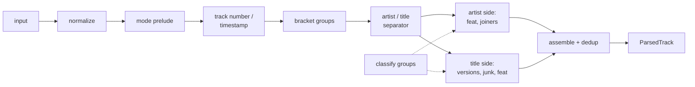

<div align="center">

# trackparse

**Turn messy track names into structured data: who made it, who's featured, who remixed it, and what's just noise.**

[](https://www.npmjs.com/package/trackparse)
[](https://pypi.org/project/trackparse/)
[](https://pypi.org/project/trackparse/)
[](https://github.com/4matic/trackparse/actions/workflows/js.yml)
[](https://github.com/4matic/trackparse/actions/workflows/python.yml)
[](https://github.com/4matic/trackparse/actions/workflows/spec.yml)
[](spec/fixtures)
[](js/package.json)
[](https://www.npmjs.com/package/trackparse)
[](js/src/types.ts)
[](LICENSE)

[Install](#install) · [Quick start](#quick-start) · [What it understands](#what-it-understands) · [Tracklists](#tracklists) · [How it's tested](#how-its-tested) · [API](#api) · [Spec](spec/SPEC.md)

</div>

```text
01. Wilkinson ft. Becky Hill & Tom Cane - Afterglow (Sub Focus VIP Remix) [Official Video]
└┬┘ └───┬───┘ └───────────┬───────────┘   └───┬───┘ └─────────┬─────────┘ └───────┬──────┘
 │      │                 │                   │               │                   │
 position 1               featured ×2         title           remix · Sub Focus · vip
        │                                                                         │
        primary                                                                   junk: video
```

Most title parsers give you `["Wilkinson ft. Becky Hill & Tom Cane", "Afterglow (Sub Focus VIP Remix)"]`
and call it a day. Or they "clean" the string and throw the feat and the remix away. Neither
tells you that Becky Hill is featured, that Sub Focus did the remix, or that it's a VIP.

trackparse keeps all of it. Its one rule is **extract, don't delete**: everything it recognises
goes into a field, and anything it doesn't recognise stays in the title, word for word.

```js
import { parse } from "trackparse";

const track = parse(
  "01. Wilkinson ft. Becky Hill & Tom Cane - Afterglow (Sub Focus VIP Remix) [Official Video]",
);

track.artists.map((a) => `${a.name} (${a.role})`);
// [ 'Wilkinson (primary)', 'Becky Hill (featured)', 'Tom Cane (featured)' ]
track.title;                        // 'Afterglow'
track.versions[0].type;             // 'remix'
track.versions[0].artists[0].name;  // 'Sub Focus'
track.versions[0].modifiers;        // [ 'vip' ]
track.junk;                         // [ { raw: 'Official Video', kind: 'video' } ]
track.position;                     // { raw: '01', number: 1 }
```

<details>
<summary>Full output</summary>

```json
{
  "input": "01. Wilkinson ft. Becky Hill & Tom Cane - Afterglow (Sub Focus VIP Remix) [Official Video]",
  "mode": "youtube",
  "position": { "raw": "01", "number": 1 },
  "timestamp": null,
  "artists": [
    { "name": "Wilkinson",  "role": "primary",  "joiner": null,  "source": "artist" },
    { "name": "Becky Hill", "role": "featured", "joiner": "ft.", "source": "artist" },
    { "name": "Tom Cane",   "role": "featured", "joiner": "&",   "source": "artist" }
  ],
  "title": "Afterglow",
  "fullTitle": "Afterglow (Sub Focus VIP Remix)",
  "versions": [
    {
      "type": "remix",
      "raw": "Sub Focus VIP Remix",
      "artists": [{ "name": "Sub Focus", "role": "remixer", "joiner": null, "source": "version" }],
      "modifiers": ["vip"],
      "descriptor": null,
      "year": null,
      "unknownArtist": false,
      "delimiter": "("
    }
  ],
  "year": null,
  "flags": { "explicit": false, "clean": false, "unknownArtist": false, "unknownTitle": false },
  "junk": [{ "raw": "Official Video", "kind": "video" }],
  "warnings": []
}
```

Every key is always present. When a guess was involved, `warnings` says which one.

</details>

## At a glance

| Number | What it means |
|---|---|
| **12,965** shared fixtures | 1,148 written by hand, 11,817 generated from combinations. 100% pass in JS and Python, nothing skipped. |
| **1,074** of them on tracklists | 248 handwritten, 826 generated. Line splitting, times, warnings, edits |
| **1,293** JS tests | every fixture, a schema check on every output, property-based tests of the spec invariants, API tests |
| **27** version types | remix, VIP, bootleg, extended, radio, original, live, remaster, sped up, … |
| **0** dependencies | ESM + CJS + TypeScript types, about 17 kB gzipped. `trackparse/tracklist` adds about 7.6 kB, only if you import it |
| **Node 18+** | CI runs the full suite on 22 and 24, and every fixture against the built package on 18 and 20 |
| **Python 3.9+** | 1,283 pytest tests on 3.9 to 3.14, plus every fixture against the built wheel. Output is byte-identical to JS |
| **5,031** real tracklist lines | 117 podcast tracklists the tracklist rules were checked against. Every line round-trips byte for byte |
| **1 spec** | [`spec/SPEC.md`](spec/SPEC.md) defines the behaviour; the Python port passes the same fixtures, and so will Rust |

## Install

```sh
npm install trackparse   # or: pnpm add / yarn add / bun add trackparse
```

Works in Node 18+ and any runtime with ES2020.

```sh
pip install trackparse   # or: uv add trackparse
```

Python 3.9+, no dependencies. A Rust port is [on the way](#ports).

## Quick start

```js
import { parse, parseArtists, format } from "trackparse";

parse("Noisia feat. Foreign Beggars - Shellshock").artists.map((a) => a.name);
// [ 'Noisia', 'Foreign Beggars' ]   (Foreign Beggars has role 'featured')

parse("Queen - Bohemian Rhapsody (Live at Wembley 1986)").versions[0];
// { type: 'live', year: 1986, descriptor: 'at Wembley', … }

parseArtists("Sub Focus, Wilkinson & Dimension feat. Kojo").map((a) => `${a.name}:${a.role}`);
// [ 'Sub Focus:primary', 'Wilkinson:primary', 'Dimension:primary', 'Kojo:featured' ]

format(parse("Wilkinson ft. Becky Hill - Afterglow (Sub Focus Remix)"), { feat: "title", joiners: "canonical" });
// 'Wilkinson - Afterglow (feat. Becky Hill) (Sub Focus Remix)'
```

CommonJS works too: `const { parse } = require("trackparse")`.

### Python

Same parser, same output. Functions are snake_case, results are frozen dataclasses, and
`to_dict()` gives the spec's JSON with camelCase keys, identical to what the JS package returns.

```python
from trackparse import format_track, parse, parse_artists

track = parse("Noisia feat. Foreign Beggars - Shellshock")
track.artists
# (Artist(name='Noisia', role='primary', joiner=None, source='artist'),
#  Artist(name='Foreign Beggars', role='featured', joiner='feat.', source='artist'))

parse("Queen - Bohemian Rhapsody (Live at Wembley 1986)").versions[0]
# Version(type='live', raw='Live at Wembley 1986', artists=(), modifiers=(),
#         descriptor='at Wembley', year=1986, unknown_artist=False, delimiter='(')

[f"{a.name}:{a.role}" for a in parse_artists("Sub Focus, Wilkinson & Dimension feat. Kojo")]
# ['Sub Focus:primary', 'Wilkinson:primary', 'Dimension:primary', 'Kojo:featured']

format_track(parse("Wilkinson ft. Becky Hill - Afterglow (Sub Focus Remix)"), feat="title", joiners="canonical")
# 'Wilkinson - Afterglow (feat. Becky Hill) (Sub Focus Remix)'

track.to_dict()["artists"][1]
# {'name': 'Foreign Beggars', 'role': 'featured', 'joiner': 'feat.', 'source': 'artist'}
```

Options are keyword arguments: `parse(s, mode="youtube", known_artists=["Chase & Status"])`. The
full Python API is in [`python/README.md`](python/README.md).

> [!TIP]
> `&` is a joiner, so `Chase & Status` comes out as two artists. There's no built-in artist
> database. Pass the names you know instead: `parse(s, { knownArtists: ["Chase & Status"] })` in
> JS, `parse(s, known_artists=["Chase & Status"])` in Python.

## What it understands

These are real outputs of `parse(input)` with default options, unless noted.

| Input | Artists | Title | Versions / other |
|---|---|---|---|
| `Noisia feat. Foreign Beggars - Shellshock` | Noisia, Foreign Beggars *(feat)* | `Shellshock` | |
| `Silk City - Electricity (with Dua Lipa)` | Silk City, Dua Lipa *(feat)* | `Electricity` | |
| `Skrillex & Diplo x Justin Bieber - Where Are Ü Now` | Skrillex, Diplo, Justin Bieber | `Where Are Ü Now` | |
| `Future - Mask Off (prod. by Metro Boomin)` | Future, Metro Boomin *(producer)* | `Mask Off` | |
| `Linkin Park - Numb (Remix by Skrillex)` | Linkin Park | `Numb` | remix by Skrillex |
| `Dimension - Offshore (Mefjus Remix / Noisia Remix)` | Dimension | `Offshore` | two remixes |
| `Pendulum - Watercolour (Extended VIP Mix)` | Pendulum | `Watercolour` | vip, +extended |
| `Noisia - Stigma (Phace Bootleg)` | Noisia | `Stigma` | bootleg by Phace |
| `Deadmau5 - Strobe (Radio Edit)` | Deadmau5 | `Strobe` | radio |
| `Netsky - Iron Heart (Levela Mix)` | Netsky | `Iron Heart` | remix by Levela |
| `The Beatles - Hey Jude - Remastered 2015` | The Beatles | `Hey Jude` | remaster, 2015 |
| `Taylor Swift - Love Story (Taylor's Version)` | Taylor Swift | `Love Story` | version, "Taylor's" |
| `Kordhell - Murder In My Mind (Slowed + Reverb)` | Kordhell | `Murder In My Mind` | slowed |
| `Eminem - Without Me (Explicit)` | Eminem | `Without Me` | explicit flag |
| `Daft Punk - One More Time (Official Music Video) [HD]` | Daft Punk | `One More Time` | junk: video, quality |
| `Elektronomia - Sky High [NCS Release]` | Elektronomia | `Sky High` | junk: label |
| `Porter Robinson - Shelter - YouTube` | Porter Robinson | `Shelter` | junk: platform |
| `01. Aphex Twin - Xtal` | Aphex Twin | `Xtal` | position 1 |
| `[12:34] Noisia - Stigma` | Noisia | `Stigma` | timestamp 754 s |
| `07_Burial_-_Archangel.mp3` | Burial | `Archangel` | filename mode, position 7 |
| `"Numb" by Linkin Park` *(youtube)* | Linkin Park | `Numb` | ⚠ bySplit |
| `Blink-182-All The Small Things` *(youtube)* | Blink-182 | `All The Small Things` | ⚠ unspacedDashSplit |
| `Кино - Группа крови (Remastered 2019)` | Кино | `Группа крови` | remaster, 2019 |
| `ID - ID (ID Remix)` | | `ID` | unknown artist, title and remixer |
| `AC/DC - Back In Black` | AC/DC | `Back In Black` | |
| `2 Unlimited - No Limit` | 2 Unlimited | `No Limit` | not a track number |
| `Mumford & Sons - Little Lion Man` | Mumford & Sons | `Little Lion Man` | not split |
| `The Rolling Stones - (I Can't Get No) Satisfaction` | The Rolling Stones | `(I Can't Get No) Satisfaction` | kept as is |

## Tracklists

Mixes and podcasts come with a tracklist: a block of text, one track per line, usually with a start
time in front. `trackparse/tracklist` reads the whole block. Each line gets its kind, its time and a
full `ParsedTrack`. The list as a whole gets checks with line numbers, and edits rewrite only the
lines you name.

Nothing is thrown away here either. Every line comes back with its original text and its own line
ending, so joining `raw + eol` over the entries gives you the input byte for byte. CRLF, LF and CR
all work, and trailing spaces survive.

```js
import { parseTracklist, applyEdits } from "trackparse/tracklist";

const text = [
  "Hour 2",
  "48:20 Noisia - Stigma",
  "52:47 Mefjus & Kasra - Bandwagon (Phace Remix)",
  "56:05 Black Sun Empire - ID",
  "59:31 Alix Perez - Fade Away",
  "01:03:10 Interview with Hybris",
  "01:07:44 Imanu - Sacrifice",
  "00:11:02 Current Value feat. Teddy Killerz - Payload", // typo: should be 01:11:02
  "01:15:36 Hybris - Spinning Top",
].join("\r\n");

const list = parseTracklist(text);

list.entries.map((e) => e.kind);
// [ 'header', 'track', 'track', 'track', 'track', 'marker', 'track', 'track', 'track' ]

const bandwagon = list.entries[2];
bandwagon.time;   // { raw: '52:47', seconds: 3167 }
bandwagon.parts;  // { lead: '', time: '52:47', gap: ' ', rest: 'Mefjus & Kasra - Bandwagon (Phace Remix)' }
bandwagon.track.artists.map((a) => a.name);                          // [ 'Mefjus', 'Kasra' ]
bandwagon.track.versions.map((v) => `${v.type} by ${v.artists[0].name}`); // [ 'remix by Phace' ]
list.entries[3].track.flags.unknownTitle;                            // true (the ID)

list.warnings;
// [
//   { code: 'no-start-at-zero', line: 2, severity: 'info', suggestion: null },
//   { code: 'time-out-of-order', line: 8, severity: 'warning',
//     suggestion: { line: 8, raw: '01:11:02', seconds: 4262 } }
// ]

list.stats;
// { lines: 9, tracks: 7, markers: 1, timed: 8, firstTime: 2900, lastTime: 4536 }
```

`00:11:02` sits between `01:07:44` and `01:15:36`. Changing one digit gives exactly one time that
fits, `01:11:02`, so the warning carries it as a suggestion. When several fixes would fit, or none,
`suggestion` is `null` and you only get the warning.

Edits work on the text and return new text. Apply the suggestion, then push everything from line 5
on back by 45 seconds:

```js
const fix = list.warnings[1].suggestion;
const result = applyEdits(text, [
  { op: "set-time", line: fix.line, seconds: fix.seconds },
  { op: "shift", seconds: 45, from: 5 },
]);

result.changed;   // [ 5, 6, 7, 8, 9 ]
result.warnings;  // [ { code: 'style-upgraded', edit: 1, line: 5 } ]
result.text.split("\r\n").slice(4);
// [
//   '01:00:16 Alix Perez - Fade Away',
//   '01:03:55 Interview with Hybris',
//   '01:08:29 Imanu - Sacrifice',
//   '01:11:47 Current Value feat. Teddy Killerz - Payload',
//   '01:16:21 Hybris - Spinning Top'
// ]
```

Lines 1 to 4 are untouched, CRLF included. A rewritten time keeps its line's style (hours or not,
digit widths, fraction digits), so `52:47` plus 45 seconds would stay `MM:SS`. `59:31` crossed the
hour, so it became `01:00:16` to match the list's other hour times, and the edit tells you with
`style-upgraded`. A time pushed below zero stops at `00:00` and warns `time-clamped`. A bad edit
(missing line, line without a time, `NaN`) changes nothing and warns `edit-invalid`. Neither
function throws.

Python has the same functions, snake_case, with frozen dataclasses:

```python
from trackparse.tracklist import apply_edits, parse_tracklist

parse_tracklist(text).warnings[1].suggestion
# Suggestion(line=8, raw='01:11:02', seconds=4262)
apply_edits(text, [{"op": "set-time", "line": 8, "seconds": 4262}]).changed
# (8,)
```

### Tracklist mode

Inside a tracklist the first ` - ` is the artist/title separator on practically every line. A single
track string doesn't get that benefit of the doubt, so `parse()` sometimes reads the part after the
dash as a version or a genre. `parseTracklist` parses each line with `mode: "tracklist"`, which
trusts the first spaced dash. You can ask `parse()` for it too. These are real lines from a podcast
archive:

| Line | `parse(line)` | In a tracklist |
|---|---|---|
| `Electrosoul System - Liquid Metal` | title `Electrosoul System`, `Liquid Metal` as genre junk | Electrosoul System / `Liquid Metal` |
| `Effector - 2012` | title `Effector`, year 2012 | Effector / `2012` |
| `Paperclip - Anticipation VIP` | title `Paperclip`, a `vip` version | Paperclip / `Anticipation VIP` |
| `ez4cheezy - Zhukovskiy dub` | title `ez4cheezy`, a `dub` version | ez4cheezy / `Zhukovskiy dub` |
| `8 Linkin Park_-_Points Of Authority (Gydra Bootleg)` | no separator | position 8, Linkin Park / `Points Of Authority`, bootleg by Gydra |
| `10 Optiv & BTK-Inception (Gydra remix)` | no separator | position 10, Optiv, BTK / `Inception`, remix by Gydra |

The last two rows need the neighbours. A bare `8 ` only counts as a position when the nearest track
line before or after it starts with a bare 7 or 9. Dotted numbers like `01.` never count as
neighbours, so `2 Unlimited - No Limit` between `01.` and `03.` stays an artist. The tight
`BTK-Inception` dash only splits when at least half of the list uses spaced dashes.

## How it's tested

The fixtures in [`spec/fixtures`](spec/fixtures) are the source of truth. The spec says what should
happen, the fixtures pin it down, and every port has to pass all of them. The JS and Python
packages both do: **12,965 of 12,965**, with empty skip lists, in CI on every push.

Passing a fixture only checks the fields the case asserts, so
[`scripts/compare-ports.mjs`](scripts/compare-ports.mjs) also runs every fixture input through both
ports and diffs the complete outputs, tracklists and edits included. Result: 0 differences, byte
for byte.

### Handwritten: 1,148 cases in 27 files

Each case cites the spec rules it exercises. 62 of them spell out the complete output field by
field, so nothing can drift unnoticed.

| Group | Cases | What's in there |
|---|---:|---|
| Regressions | 273 | Every test from two real-world parsers this library replaces, and the known failures of get-artist-title and friends |
| Versions and brackets | 90 | Every version keyword, generic heads (`Radio Edit` → radio), multi-version groups, feat inside brackets |
| Artists | 76 | Joiners, guards (`AC/DC`, `Mumford & Sons`, `Malcolm X`), `knownArtists`, dedup |
| Title credits and producers | 57 | `Title ft. X`, `(prod. by X)`, self-produced artists |
| Separators and suffixes | 63 | Dash variants, `- Remastered 2015`, unspaced and asymmetric dashes |
| Prefixes, junk, flags | 111 | Track numbers vs `2 Unlimited`, cue times, every junk kind, years, explicit/clean |
| Modes | 65 | YouTube pipes, `"Title" by Artist`, uploader fallback, filenames |
| Unicode and normalization | 71 | NFC, zero-width characters, fullwidth brackets, Cyrillic, CJK, Turkish İ |
| `format`, `parseArtists`, unknown IDs | 94 | Round-trips, canonical joiners, `ID - ID` |
| Tracklist mode | 50 | All 17 real podcast lines that single-line `parse()` gets wrong, the 6 real lines with no separator at all, `parse(s, { mode: "tracklist" })` |
| Tracklist lines and times | 60 | LF/CRLF/CR, trailing spaces, line kinds, every time form, brackets, gap separators, `=>` arrows, invalid times |
| Tracklist positions | 12 | The real 81-line list numbered `1 ` to `81 ` without dots, and the `2 Unlimited` guard |
| Tracklist warnings | 35 | Each code with its near-miss, and the 10 real out-of-order lists with their suggestions |
| Tracklist edits | 70 | `set-time` style keeping, shift, clamp, `sort-by-time`, insert/delete line endings, invalid edits, locality |

### Generated: 11,817 cases

A deterministic generator in [`spec/generator`](spec/generator) builds inputs from small "atoms": an
artist, a joiner, a feat placement, a version group, a junk suffix. Each atom carries its own
expected contribution. The expected output is assembled from those atoms and never comes from
running a parser, so the generator can't just agree with the code it is testing.

| Scenario | Cases | | Scenario | Cases |
|---|---:|---|---|---:|
| artists × joiners | 1,811 | | kitchen sink (pairwise + random) | 1,589 |
| versions | 1,650 | | junk × YouTube | 806 |
| dash suffixes | 1,174 | | filenames | 780 |
| dedup | 1,008 | | unicode | 674 |
| feat placement | 922 | | prefixes | 577 |
| tracklists | 826 | | | |

The tracklist scenario crosses time forms (`MM:SS`, `H:MM:SS`, fractions, long minutes) with
brackets, gap separators, position styles, line endings, an extra blank, header or note line, and
the warning each combination should raise.

### Properties

[fast-check](https://github.com/dubzzz/fast-check) throws thousands of random strings at the parser to
check the invariants from the spec ([Hypothesis](https://hypothesis.works) does the same for the
Python port):
- it never throws, on any input;
- a 10,000-character input stays linear;
- `normalize` is idempotent;
- whitespace, dash and zero-width noise don't change the result;
- every output validates against the schema;
- no word of the input goes missing;
- `parse(format(parse(s)))` round-trips.

For tracklists, on random multi-line text and random edit lists:
- `raw + eol` over all entries gives the input back, and `lead + time + gap + rest` gives `raw`;
- `applyEdits(t, [])` returns `t`, and an edit never touches a line it doesn't name;
- `shift(+s)` then `shift(-s)` restores the text when nothing was clamped or upgraded;
- 10,000 lines parse in linear time (under 1 s in JS);
- a one-line list gives the same track as `parse(rest, { mode: "tracklist" })`.

### Real tracklists

The tracklist rules were written against a real corpus: all 117 tracklists of the Neuropunk
podcast, 5,031 lines, exported from the label's platform. The corpus is not
redistributable, so it stays out of git (`spec/corpus/` is ignored), but every surprising line in
it became a handwritten fixture. [`scripts/corpus-check.mjs`](scripts/corpus-check.mjs) runs the
built package over it and asserts:

- every list round-trips byte for byte, and every line's parts join back into the line;
- every line's seconds match what the platform's current player regex reads;
- all 81 bare positions of the one list numbered without dots are found;
- all 10 real out-of-order times are flagged, one per list, and exactly 2 get a suggestion (for the
  other 8, changing one or two digits gives either no fitting time or more than one);
- only 2 lines stay `line-unparsed`, and both really have no separator
  (`Gydra & Ihr Caliban`, `Grinda & Nic ZigZag`).

The whole corpus parses in about 0.4 s.

```sh
pnpm install
pnpm test          # fixtures, properties, generator tests
pnpm conformance   # pass rate per fixture file and per spec rule
pnpm --filter trackparse build && node scripts/corpus-check.mjs spec/corpus/<file>.jsonl

cd python && uv run pytest   # the same fixtures and invariants in Python
```

## API

### `parse(input, options?)` → `ParsedTrack`

| Field | Type | |
|---|---|---|
| `input` | `string` | The original string, untouched |
| `mode` | `"clean" \| "youtube" \| "filename" \| "tracklist"` | Resolved mode |
| `position` | `{ raw, number } \| null` | Track number (`"01"` → 1) |
| `timestamp` | `{ raw, seconds } \| null` | Leading cue time (`"1:02:03"` → 3723) |
| `artists` | `Artist[]` | Primary, featured and producer credits. Remixers live in `versions` |
| `title` | `string` | Clean title. Brackets it doesn't recognise stay in |
| `fullTitle` | `string` | `title` with versions re-attached |
| `versions` | `Version[]` | Remixes and versions, left to right |
| `year` | `number \| null` | From `(2015)` or `- 2015` |
| `flags` | `{ explicit, clean, unknownArtist, unknownTitle }` | |
| `junk` | `{ raw, kind }[]` | What was removed, and what kind of noise it was |
| `warnings` | `string[]` | Heuristics that fired |

<details>
<summary><code>Artist</code>, <code>Version</code>, junk kinds and warnings</summary>

**Artist:** `{ name, role, joiner, source }`

- `role` is `primary`, `featured`, `remixer` or `producer`. `&`, `x` and `vs.` are joiners, not roles.
- `joiner` is the text before the name as written (`"&"`, `","`, `"ft."`, `"prod. by"`), or `null`
  for the first name in a list.
- `source` is where the credit came from: `artist` (left of the dash), `title` (right of it) or
  `version`.

**Version:** `{ type, raw, artists, modifiers, descriptor, year, unknownArtist, delimiter }`

- `type`: `remix` `bootleg` `vip` `edit` `flip` `refix` `rework` `mashup` `blend` `dub` `mix`
  `extended` `radio` `club` `original` `instrumental` `acapella` `live` `acoustic` `remaster` `demo`
  `reprise` `cover` `version` `spedUp` `slowed` `nightcore`
- A generic word takes its type from the word in front of it: `Radio Edit` → radio,
  `Extended Mix` → extended. `<Name> Mix` is a remix by that name.
- `modifiers` holds words that didn't become the type (`Extended VIP Mix` → vip, `["extended"]`).
  `descriptor` holds leftover text (`"Taylor's"`, `"at Wembley"`, `"D'n'B"`).
- `delimiter` is `(`, `[`, `{`, or `-` for dash suffixes.

**Junk kinds:** `video`, `audio`, `lyrics`, `quality`, `promo`, `platform`, `label`, `genre`, `other`.
The vocabulary is in [`spec/data`](spec/data).

**Warnings:** `noSeparator`, `ambiguousSeparator`, `unspacedDashSplit`, `asymmetricDashSplit`,
`bySplit`, `quotedTitleSplit`, `ambiguousMixCredit`, `unbalancedBrackets`.

</details>

### Options

| Option | Default | |
|---|---|---|
| `mode` | `"auto"` | `"clean"`, `"youtube"`, `"filename"`, `"tracklist"`, or detect from the string |
| `knownArtists` | `[]` | Names that are never split (`Chase & Status`, `Earth, Wind & Fire`) |
| `uploader` | – | YouTube channel, used as the artist when there's no separator (`- Topic` and `VEVO` are dropped) |
| `splitAnd` | `"auto"` | `and` splits only after a comma (`A, B and C`), so `Simon and Garfunkel` stays whole |
| `keywords` | – | Extra vocabulary: `versionHeads`, `descriptors`, `genres`, `junk`, `featMarkers` |

### Other functions

| Function | |
|---|---|
| `parseArtists(input, options?)` | Split a bare artist string into credits |
| `format(track, options?)` | Render back to a string. Options: `feat` (`source`/`artist`/`title`/`omit`), `featMarker`, `joiners` (`original`/`canonical`), `versions`, `producers`, `position` |
| `normalize(input)` | The Unicode cleanup every function runs first: NFC, invisible characters, dash, bracket and quote variants |
| `allArtists(track)` | Credits plus every remixer, deduplicated |
| `createParser(options)` | Compile options once for repeated calls; per-call options merge over them |
| `SPEC_VERSION` | The spec version this build implements |

```js
import { createParser } from "trackparse";

const parser = createParser({
  knownArtists: ["Chase & Status", "Camo & Krooked"],
  keywords: { versionHeads: { rerub: "rework" } },
});

parser.parse("Chase & Status x Camo & Krooked - Track (Alix Perez Rerub)").versions[0].type; // 'rework'
```

### Modes

| Mode | For | Adds |
|---|---|---|
| `clean` | Store metadata, tags | Only a spaced dash separates artist and title |
| `youtube` | Video titles, scrobbles | Pipe segments, `"Title" by Artist`, `Artist: "Title"`, unspaced dashes, trailing junk, uploader fallback |
| `filename` | Files | Strips the extension, `_` → space, `01-Track` numbering |
| `auto` | Anything | `filename` for known extensions, `youtube` when it sees junk, pipes or platform suffixes, `clean` otherwise |
| `tracklist` | One line of a tracklist | The first spaced dash always separates, and the words right after it are never read as a version or genre suffix. `_-_` splits too. `auto` never picks it |

### Tracklist API

Import from `trackparse/tracklist` (Python: `trackparse.tracklist`). It's a separate entry, so code
that only parses single tracks never loads it.

#### `parseTracklist(text, options?)` → `Tracklist`

`{ specVersion, entries, warnings, stats }`, every key always present. One entry per line:

| Field | Type | |
|---|---|---|
| `line` | `number` | 1-based |
| `kind` | `"track" \| "marker" \| "header" \| "link" \| "note" \| "blank"` | See below |
| `eol` | `"\n" \| "\r\n" \| "\r" \| ""` | The line's own terminator; `""` on a last line without one |
| `raw` | `string` | The line exactly as written, never normalized |
| `parts` | `{ lead, time, gap, rest }` | `raw` cut into four strings that join back into it. `lead` is spaces or an opening bracket, `gap` is what sits between the time and the track (`] `, ` - `, ` \| `, ` => `) |
| `time` | `{ raw, seconds } \| null` | `12:34`, `1:02:03`, `125:30` (long mixes), `00:00:07.500` (7.5 s) |
| `track` | `ParsedTrack \| null` | Parsed from `rest` in tracklist mode. Only `track` and `marker` lines have one |

Kinds: a line with a time is a `marker` when it has no separator and a word like `intro`, `break`
or `interview` ([`spec/data/marker-words.json`](spec/data/marker-words.json)), otherwise a
`track`. Without a time, a URL is a `link`, `Tracklist:` or `Part 2` is a `header`, a line with a
separator is a `track`, and anything else is a `note`. No line is ever dropped.

`stats` is `{ lines, tracks, markers, timed, firstTime, lastTime }`.

`warnings` are `{ code, line, severity, suggestion }`, sorted by line. Per-line `ParsedTrack`
warnings stay on `entries[i].track.warnings` and are not repeated here.

| Code | Severity | When |
|---|---|---|
| `time-missing` | warning | A track line has no time while other lines do |
| `time-out-of-order` | warning | Earlier than the previous timed line. May carry a `suggestion` |
| `time-duplicate` | warning | Same time as the previous timed line |
| `no-start-at-zero` | info | The first time isn't `0:00` |
| `time-after-audio-end` | warning | Past `audioSeconds` |
| `invalid-time` | warning | Looks like a time but isn't one (`1:75`, `0:61:00`). The line keeps it in `rest` |
| `position-gap` | warning | A track number isn't the previous one + 1 |
| `position-duplicate` | warning | Same track number as the previous one |
| `line-unparsed` | warning | A track line with no artist/title separator, or with nothing after the time |

A `suggestion` is `{ line, raw, seconds }`: the one time, one or two digits away from the
original, that puts the line back in order. If no time fits, it tries the previous timed line
instead, since sometimes that is the typo (`01:22:21` followed by `01:03:55` suggests fixing the
first one to `01:02:21`). Several candidates or none give `null`.

#### `applyEdits(text, edits, options?)` → `{ text, changed, warnings }`

Edits run in order, each on the result of the one before, with line numbers as that text has them.

| Edit | Effect |
|---|---|
| `{ op: "set-time", line, seconds }` | Rewrite the time on that line |
| `{ op: "shift", seconds, lines?, from? }` | Add `seconds` (negative to go back) to the listed lines, to every timed line from `from` on, or to all of them |
| `{ op: "sort-by-time" }` | Reorder by time. Untimed lines move with the timed line above them |
| `{ op: "set-rest", line, rest }` | Replace everything after the time, for example with `format(track)` |
| `{ op: "insert", after, text }` | Insert a line (`after: 0` puts it at the top). It gets the text's usual line ending |
| `{ op: "delete", line }` | Remove a line |

`changed` lists the final line numbers of every line an edit wrote. Every other line keeps its
bytes and its line ending. Edit warnings are `{ code, edit, line }`, where `edit` is the index in
`edits`:

| Code | When |
|---|---|
| `style-upgraded` | A time without hours passed one hour and gained them (`59:31` → `01:00:16`) |
| `time-clamped` | A time would go below zero and was set to zero |
| `edit-invalid` | Missing line, no time to set, a non-finite number, a time too large to write, a line break in `text`/`rest`, an unknown `op`. That edit changed nothing |

#### Options

Both functions take the same options. `applyEdits` accepts them for symmetry; edits don't depend on
them.

| Option | Default | |
|---|---|---|
| `mode` | `"tracklist"` | Mode for each line's `parse()` |
| `knownArtists`, `splitAnd`, `keywords` | | As for `parse()` |
| `audioSeconds` | – | Length of the audio; enables `time-after-audio-end` |
| `markerWords` | `[]` | Extra marker words: with `["drop"]`, `03:00 Drop` is a marker, not a track |

Python uses keyword arguments (`audio_seconds=`, `marker_words=`) and plain dicts for edits, with
the same keys as JS: `{"op": "shift", "seconds": 45, "from": 5}`.

## How it works

A fixed pipeline of hand-written scanners. There are no regexes with lookaround and no
backtracking, so it runs in linear time and ports to Python and Rust with the same output.



Brackets are swapped for placeholders before anything is split, so a `&` inside `(Chase & Status
Remix)` can't break the artist list. Groups are classified on their own: junk, feat, producer, flag,
year, version, or unknown. Unknown ones go back into the title untouched. The full rules, R0–R12,
are in [spec/SPEC.md](spec/SPEC.md).

Tracklists (R13) sit on top of that. The text is split into lines with their terminators, a small
scanner reads the time at the start of each line, and the rest goes through the same pipeline in
tracklist mode. Two things look across lines: bare track numbers are only accepted when a neighbour
continues the sequence, and the unspaced-dash split is only switched on when most of the list uses
spaced dashes. The checks run last, over the finished entries.

## Ports

| Language | Package | Status |
|---|---|---|
| JavaScript / TypeScript | [`trackparse`](https://www.npmjs.com/package/trackparse) on npm | reference implementation, 12,965 / 12,965 fixtures, tracklists as `trackparse/tracklist` |
| Python | [`trackparse`](https://pypi.org/project/trackparse/) on PyPI | 12,965 / 12,965 fixtures, output identical to JS, tracklists as `trackparse.tracklist` |
| Rust | `trackparse` on crates.io | planned, same fixtures |

Want another language? The porting checklist is in [AGENTS.md](AGENTS.md).

## Compared to other libraries

| | trackparse | [get-artist-title](https://github.com/goto-bus-stop/get-artist-title) | [metadata-filter](https://github.com/web-scrobbler/metadata-filter) | [track_parser](https://rubygems.org/gems/track_parser) |
|---|---|---|---|---|
| Output | structured object | `[artist, title]` | cleaned strings | artists, feat, remixer |
| Artists as a list with roles | ✅ | – | – | `&` / `and` only |
| Remixers and version types | ✅ 27 types | – | removed | raw remix name |
| Noise | returned with a kind | removed | removed | – |
| Cross-language spec | ✅ | – | – | – |
| Last release | 2026 | 2021 | active | 2015 |

These libraries are fine at what they set out to do. If all you need is a clean string to scrobble,
metadata-filter is great. get-artist-title's YouTube test cases helped shape several rules here.
trackparse is for when you need to know who did what.

## Limitations

Not there yet:

- Tracklists that give each track's length instead of its start time. Times are always read as
  start times.
- Times at the end of a line (`Noisia - Stigma [12:34]`) and time ranges (`00:00 - 05:30`). A
  trailing time stays in the title. In a range only the start is the line's time; the end ends up
  in `track.timestamp` and nothing checks it.
- Label and catalogue numbers (`[HOSP123]`) as fields. Label-like groups currently land in `junk`.
- Key and BPM (`8A`, `174 BPM`).
- An artist database. `Earth, Wind & Fire` splits unless it's in `knownArtists`, and a tracklist
  doesn't yet learn names from its other lines.

Planned next: the Rust port, then a browser playground.

## Contributing

Behaviour changes start in the spec: a rule in [SPEC.md](spec/SPEC.md), a fixture that pins it,
then the code. [AGENTS.md](AGENTS.md) has the repo map, the workflow and every command. The most
useful bug report is an input string plus the output you expected. It usually becomes a fixture
as is.

## License

[MIT](LICENSE) © Maksim Maksimov. Some regression inputs come from the test suite of
[get-artist-title](https://github.com/goto-bus-stop/get-artist-title) (MIT, © 2016 René Kooi); see
[THIRD_PARTY_NOTICES.md](THIRD_PARTY_NOTICES.md).
